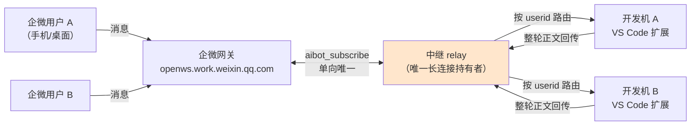
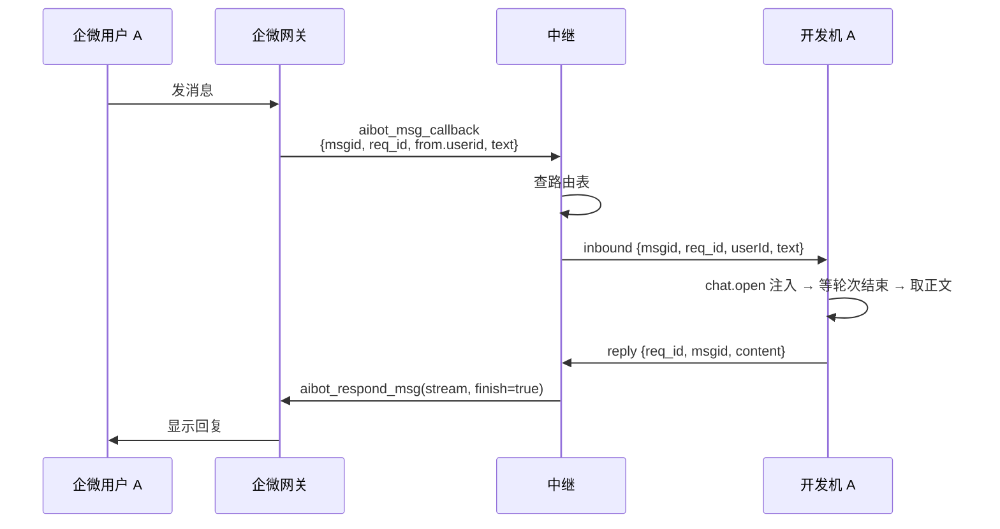

# 路径 C：一个企微智能机器人服务多人数机 · 方案设计

> 状态：**设计稿，未实现**。本文只写方案与契约，不含实现代码。
> 日期：2026-10-31。平台侧事实核实来源见 §3，实现前须复核是否仍然成立。
> **已决策（2026-10-31）：走 C1（长连接 + 中继）。** C2（URL 回调多实例）暂不展开，仅作为可用性升级路径保留在 §6。

---

## 1. 结论摘要

当前插件是"一人一机器人一机器"：`bot_id` + `secret` 存在本机 `SecretStorage`，长连接由本机扩展宿主独占。这条路（下称**路径 A**）受企微**单企业 300 个机器人**配额约束，且一人一 bot 无法集中运维。

**路径 C** 的目标：让 **1 个机器人** 服务 **N 个人 × N 台开发机**。

核心结论三条，决定了整个方案的形状：

1. **必须有一个唯一接入点**。长连接模式下企微明确"同一机器人仅允许一个有效连接"（`101806`），这是平台硬约束。因此接入角色只能有一个进程，本文称 **中继（relay）**。
2. **凭据只能留在中继**。既然只有中继能用 `secret` 建连，那么所有出站消息（回复、主动推送）都只能由中继发出。开发机**不持有 secret**、**不能直连企微**——这一点反而是安全收益。
3. **开发机必须出站连接**。开发机通常在内网、无公网 IP。中继↔开发机只能是"开发机主动连中继"的反向注册模型，不能是中继回连开发机。

由此得到的整体形状：



**中继是单点**：它挂了所有人一起断。C1 的缓解手段是进程守护与自动恢复（§4.8），真正的多实例高可用只有切到 URL 回调模式（C2，见 §6）才能拿到。

---

## 2. 决策前置：什么时候真的需要 C

在动工前必须先回答这三问，否则容易过度工程：

| 问题 | 若答案偏向… | 建议 |
|---|---|---|
| 真正会同时使用的人有多少？ | ≤ 200 | 先用路径 A，不建中继 |
| 需要的是"手机问、本机答"，还是"手机上只看结果"？ | 后者占多数 | 混合：多数人用群 webhook 推送（无配额），少数人用路径 A |
| 是否必须集中管理凭据、不把 secret 发给个人？ | 是 | 路径 C 的正当理由成立 |

**配额换算**：路径 A 的极限 = 单企业 300 个机器人 = 300 人（1 bot ↔ 1 人）。单成员 20 个的配额在这里不构成瓶颈。

**未验证**：300 能否向企微申请扩容（官方文档只提"停用/删除释放名额"，未提扩容通道）。若存在扩容通道，路径 A 的适用人数上限会被抬高，路径 C 的必要性需重估。

---

## 3. 平台硬约束（事实，非本仓库设计选择）

| # | 约束 | 来源 | 对方案的影响 |
|---|---|---|---|
| C1 | 长连接模式下同一机器人仅允许一个有效连接 | `101806` | 必须有唯一接入点 |
| C2 | 新订阅会顶掉旧连接，旧连接收到 `disconnected_event` | `101806` + 本仓库实测 | 中继之外任何进程持 secret 都会引发踢号风暴 |
| C3 | URL 回调模式支持多实例负载均衡 | `101806` | 唯一的真正高可用路径，但门槛高（见 §6） |
| C4 | `aibot_respond_msg` 复用回调的 `req_id`，首次推送后 10 分钟内必须 `finish` | 现有 instructions §4 | `req_id` 必须由中继透传，否则回不了原会话 |
| C5 | 每会话 30 条/分钟、1000 条/小时，回复与主动推送合并计数 | 现有 instructions §4 | 限流必须集中在中继计数，不能各机自算 |
| C6 | `from.userid` 是 32 字符加密值 | 现有 instructions §4 + 实测 | 它就是稳定的路由键，无需另建用户 ID |
| C7 | 单企业 300 个机器人；单成员 20 个 | `help2/pc/21663` | 路径 A 的天花板 |
| C8 | "使用模式：多人使用" = 共享创建者的数据访问权限 | `help2/pc/21663` | **与本文无关**：路径 C 共享的是机器人接入，不是数据权限；启用多人使用时务必收窄成员范围 |

**未验证**：`from.userid` 的加密值是否**跨机器人**稳定（即同一人在两个不同的 bot 下加密值是否相同）。本方案只在单个 bot 内路由，因此**无论是否跨 bot 稳定都不影响设计**；但若将来要做跨机器人合并身份，先验证这一条。

---

## 4. 关键设计

### 4.1 唯一接入点：中继

中继是唯一持有 `bot_id` / `secret` 的进程，职责收敛为"搬运"：

- 持有唯一长连接，维持 30 秒 `ping` 心跳。
- 收到 `aibot_msg_callback` → 抽 `msgid / req_id / chattype / from.userid / text` → 查路由表 → 转发给对应开发机。
- 收到开发机回传的正文 → 用**透传下来的 `req_id` + `msgid`** 发 `aibot_respond_msg`。
- **不解析业务语义**：不理解 prompt、不理解答案格式、不做上下文裁剪。这样中继的演进与插件的对话逻辑解耦。
- **不落正文**：日志只记 `msgid`、`userId 的长度`、`content 字节数`，与本仓库现有日志纪律一致。

中继不做的事，明确写下来防止膨胀：不做模型调用、不做知识库、不做 prompt 改写、不做多轮记忆。

### 4.2 路由键与身份绑定

路由键 = `from.userid`（C6）。但**绝不能只靠开发机自报 `userid`**——那样任何人都能声明自己是某位同事并接收其消息。

绑定流程（推荐，复用现有"发一条消息触发授权"的交互习惯）：

1. 管理员在企微后台把机器人**可见范围**设为目标人群（这是第一道闸，非可见范围的人根本发不了消息）。
2. 开发机首次启动，本地生成一次性**绑定码**（6–8 位，5 分钟有效，单次使用），显示在面板上。
3. 用户把它发到企微对话里 → 中继收到 `from.userid` + 码 → 建立 `userid ↔ 开发机会话` 绑定，回一句"已绑定"。
4. 绑定关系存中继侧（建议持久化），可解绑、可重绑；一人多机时只保留最近活跃的一台。

绑定码而不是"谁先发消息谁就绑上"，是为了避免恶意抢绑：可见范围内的人若先发一条消息就能占位，等于抢账号。

### 4.3 正文回传与代发

开发机**没有** secret，因此无法自己 `aibot_respond_msg`。链路是：



几个不能省的细节：

- **`req_id` 必须原样透传**。它是企微回调的唯一凭证，换一个就回不到原会话（C4）。
- **10 分钟窗口变成中继的责任**。开发机侧现在有 `respondTimeoutSeconds`（默认 900 秒），中继必须**早于** 10 分钟给出终态（例如 8 分钟回一句"这一轮还没跑完，稍后主动推送"），否则消息永远停在未完成态。建议把这个超时上移到中继，开发机侧降为 7 分钟。
- **超时后的长轮次怎么收场**：开发机跑完后走"主动推送"通道（`aibot_send_msg`），这条不依赖 `req_id`，但同样只能由中继发。所以中继需要两个入口：`reply`（回原回调）与 `push`（主动推送）。
- **仍然不逐 token 流式**：保持"整轮结束一次性回"的现状语义，降低中继复杂度。若将来要流式，中继可以边收边发增量、最后 `finish=true`，属于可选增强，不影响本文结构。

### 4.4 提问作答回路（「等你选择」）

现有实现是本机 hook 写 sidecar → 本机读 → 推给企微 → 手机回编号 → 本机执行 `_chat.notifyQuestionCarouselAnswer`。中继模式下这条链路要跨机：

1. 开发机 A 侧 hook 落到 sidecar → 渲染成提醒 → 发给中继 `interaction {req_id, markdown}`。
2. 中继用 `aibot_send_msg` 推给 A 的 `userid`，并在会话状态里记下"A 当前有一个待答提问"。
3. 企微来消息时，中继若发现该 `userid` 有未过期待答状态，**优先走作答通道**：转发 `answer {req_id, text}` 给 A，而不是 `inbound`。
4. A 侧解析后执行作答命令，回 `reply` 确认；A 侧收到 `done`（PostToolUse hook）后通知中继清除待答状态。

必须保留的语义（都是踩过坑换来的，别在中继里重写一遍）：

- **待答状态必须带 TTL**（现有 10 分钟），过期后不能假装作答成功。
- **裸文字不当答案**：作答语法（裸编号 / `答 内容` 前缀 / `跳过`）仍在开发机侧解析，中继不碰。
- **收场只能靠 PostToolUse**：`executeCommand` 的成功是假的，中继更不能凭"我转发过了"就当已答。
- **路由要双向**：待答状态是 `userid → 开发机` 的强绑定，同一用户换机时不继承。

### 4.5 会话隔离

一人一机时不存在这个问题；中继模式下必须显式保证：

- 中继的转发单元是 `(userid, 开发机会话)`，A 的消息**物理上**只发到 A 的 socket。
- 开发机侧维持现有语义：注入 `workbench.action.chat.open` 打到本机当前/专用会话，不跨机。
- 中继拒绝"未绑定 userid"的消息（现有实现是静默丢弃，不回"无权限"，避免成为探测工具——这条纪律要保留）。
- 一条开发机同时只服务一个 `userid`。同一台机器被两个账号绑定视为冲突，需先解绑。

### 4.6 租约（lease）粒度变化

现有 `wechatBridgeLease.ts` 解决的是**同一台机器多个 VS Code 窗口互踢**（`globalStorageUri` 下的文件 + 15 秒心跳 + 60 秒陈旧）。中继模式下：

- **中继侧**新增在线表：`userid → 开发机会话 + lastSeenAt`。同一 `userid` 新会话注册时顶掉旧会话（并通知旧会话"已被顶号"），避免一个人在两台机器上抢同一条消息。
- **开发机侧**租约保留，语义从"本机谁持有唯一长连接"改为"本机哪个窗口持有该 userid 的执行权"，粒度从全局变成 per-userid。
- 现有租约文件的局限（不是真正的跨进程锁）在中继模式下变得无害：中继的在线表是唯一裁决者。

### 4.7 限流与去重

- **限流集中在中继**（C5：每会话 30/分钟、1000/小时，回复与主动推送合并计数）。开发机侧现有的"25/分钟、900/小时留余量"策略上移到中继，开发机不再自算。
- **`msgid` 去重在中继**做一次（企微会因网络原因重复推送），开发机保留现有的 `SEEN_MSGID_LIMIT` 作为第二道闸。
- **群通知去重台账**（`%TEMP%/libiao-copilot-bridge-prompts.jsonl`）仍留在开发机：它服务于本机 `WechatNotify.ps1` 的 Stop hook，与中继无关。

### 4.8 C1 落地前提（定稿后必须回答的四件事）

C1 只要求“中继出站连企微”，但下面四件事必须先有答案，否则阶段 1 写不下去：

1. **中继地址怎么到达开发机**
   - 推荐：面板里手填 `relay://host:port` + 一次性令牌，与现在手填 `bot_id`/`secret` 的交互习惯一致，零新增基础设施。
   - 不建议：写死在扩展里、靠 DNS 自动发现、或用公司内部短域名——都会把部署位置固化成发布约束。
   - 中继侧配置（`bot_id`/`secret`/监听地址/令牌签发）放中继自己的配置文件或环境变量，**不要再进 VS Code 的 SecretStorage**。
2. **单点怎么缓解**
   - 进程守护（systemd / NSSM / 容器 restart policy）+ 启动即重连长连接。
   - 开发机侧断线**指数退避重连**，退避策略沿用现有 `RECONNECT_BACKOFF_MS`（2/5/10/30/60 秒），不要更密。
   - 中继重启后路由表要从持久化恢复；不能恢复时开发机重新注册，用户最多收不到一条已发在途的消息——**这个取舍要在文档里写明，不要装作无感**。
3. **长连接被顶时中继怎么办**
   - 中继自己是唯一持有者，但仍可能出现“有人误用同一份 secret 在别处建连”。现有 `markKicked()` 语义（收到 `disconnected_event` 后永久停重连）在中继上**继续保留**——否则会和新连接形成踢号风暴。
   - 区别在于告警：中继被踢时必须能通知到人（日志 + 一个可选的企微侧提示），而不是默默失联。
4. **开发机回落到路径 A 时不会互相打扰**
   - 回落开关是手动的（面板设定“直连/走中继”），不做自动切换：自动切换会在中继抖动时把所有开发机同时拉回直连，反而把长连接顶成一锅粥。
   - 回落时开发机必须用**自己的** bot，不能共用中继那份 secret（否则立刻踢掉中继）。

---

## 5. 组件划分与代码复用映射

| 现有模块 | 路径 C 下的归属 | 处理方式 |
|---|---|---|
| `wechatBridgeProtocol.ts`（纯函数帧构造/解析） | 中继 **+** 开发机 | 帧构造归中继（只有它发帧）；`extractInbound*` 归中继。开发机不再需要协议层 → 可整体剥离 |
| `wechatBridgeConnection.ts`（`ws` 长连接、重连退避、踢号处理） | 中继 | 搬过去。扩展侧删除或降级为"不走长连接"的兼容分支 |
| `wechatBridgeService.ts`（队列、白名单、作答、TTL） | 开发机 | 保留，但入站来源从长连接换成"中继 socket"；白名单/绑定校验上移到中继 |
| `wechatBridgeStore.ts`（SecretStorage / globalState） | 中继持有凭据；开发机只存 `relayUrl` + 本机绑定态 | 开发机侧**不再需要 secret**，SecretStorage 中相关键需清理 |
| `wechatBridgeLease.ts` | 开发机 | 保留，粒度改为 per-userid（§4.6） |
| `wechatBridgeLiveTurns.ts` / `wechatBridgeTranscript.ts` | 开发机 | 不动 |
| `wechatBridgeInteractions.ts` / `WechatInteract.js` | 开发机 | 不动，只把"推送"从 `connection.send` 改为"发给中继" |
| `wechatBridgeAnswers.ts` | 开发机 | 不动 |
| `wechatBridgePromptLedger.ts` | 开发机 | 不动 |

结论：**扩展侧主要变的是"出站通道"和"入站来源"两处；对话正文、提问作答、去重台账这些一天天踩出来的逻辑全部留在原地。** 这是本方案能落地的关键——不要让中继吞掉业务逻辑。

中继本身建议是**独立仓库/独立服务**，不要把服务器代码塞进 VS Code 扩展仓库。

---

## 6. 两种变体：C1 长连接中继 vs C2 URL 回调多实例

| 维度 | **C1：长连接 + 中继**（**已选定**） | C2：URL 回调 + 多实例（未选，仅备查） |
|---|---|---|
|---|---|---|
| 公网要求 | 无（中继出站连企微即可，可部署在内网服务器） | **必须**公网 IP + 域名 + HTTPS |
| 高可用 | 中继单点，挂则全挂 | 官方支持多实例负载均衡（C3） |
| 加密负担 | 明文 JSON，无需加解密 | 需 Token / EncodingAESKey、`msg_signature` 校验、AES 解密 |
| 回调响应 | 长连接推送，无需应答超时 | HTTP POST 必须数秒内响应，否则企微重试 |
| 实现起点 | 可复用现有 `wechatBridgeConnection.ts` 与协议层 | **本仓库零基础**，全部从零 |
| 适合场景 | 公司内网一台常开服务器 | 真的要做成对外服务、要求 SLA |

**已决策走 C1**（2026-10-31）：它把“一个 bot 服务多人”这件事跑通，工程量集中在路由与身份，且能复用现有 `wechatBridgeConnection.ts` 与协议层。C2 留作后续可用性升级路径：它解决的是可用性而不是路由，§4 的路由与身份设计可以整体复用，只在接入层重写。

**选 C1 时接受的两个代价**（写下来供日后复盘，不要当成已经解决）：

- 中继单点，挂则全员不可用；只能靠进程守护缩短中断时长，做不到无缝。
- 不强制公网，但不能假设“内网就一定安全”：中继能看到全部对话明文，传输层必须 TLS（`wss`），且不落正文。

---

## 7. 中继 ↔ 开发机契约草图

> 仅为契约形状，不是实现。传输建议 WebSocket（开发机出站），双向 JSON 文本帧。

```
开发机 → 中继
  { type: "register",  token, machineId, workspaceName, capabilities: ["interaction","push"] }
  { type: "reply",     reqId, msgid, content, ok }
  { type: "push",      content }                       // 超时后的长轮次收场
  { type: "interaction", reqId, markdown }             // 「等你选择」提醒
  { type: "answered",  reqId, ok }                     // 作答结果回执（供中继清待答态）
  { type: "interaction-closed" }                       // PostToolUse done → 清待答态
  { type: "heartbeat" }

中继 → 开发机
  { type: "registered", userId }                        // 绑定成功，回传路由键
  { type: "inbound",   msgid, reqId, userId, chatType, content }
  { type: "answer",    reqId, content }                 // 该 userid 有待答提问时走这里
  { type: "evicted",   reason }                          // 同一 userid 在其他机器登录
  { type: "rate-limited", retryAfterMs }
```

不变量（写成断言，别靠约定）：

1. `register` 必须带一次性令牌；无令牌或令牌过期一律断开。
2. 一个中继连接最多绑定一个 `userId`。
3. 任何来自开发机的 `reply`，其 `reqId` 必须是中继先前下发的、且未被消费过的。
4. 中继对同一 `reqId` 只发一次终态。
5. 正文不落盘、不进日志。

---

## 8. 分阶段落地

| 阶段 | 目标 | 交付 | 可验收点 |
|---|---|---|---|
| **0 量化** | 确认是否真需要 C | 人数与场景清单 | 决策记录：为何不选 A/B（已完成：选 C1） |
| **1 中继骨架** | 1 人 1 机跑通 | 中继持有唯一长连接；开发机出站注册；`inbound`/`reply` 闭环；`relayUrl` 手填 + 令牌 | 手机发消息 → 本机起轮次 → 正文回到手机；全程无第二条长连接；中继重启后开发机能自动重连 |
| **2 多人路由** | N 人 N 机 | 绑定码 + 路由表 + 在线表 + 顶号处理 | A/B 同时在线互不串消息；A 换机后旧机收到 `evicted` |
| **3 提问回路** | 「等你选择」跨机 | `interaction` / `answer` / `interaction-closed` | 手机上回编号能答上指定那台机器；在电脑上答完手机不再收到假成功 |
| **4 运维** | 可长期运行 | 集中限流、可观测（只记元数据）、部署与回滚 | 30/分钟限流触发有明确回执；中继重启后开发机自动重连并恢复路由 |

阶段 1 建议直接在中继里把 10 分钟流式窗口的超时收场做掉（§4.3），不要留到阶段 4：它是 C1 的基础路径，后补会返工。

每阶段结束都必须留下**手动降级开关**：扩展可切换为直连（路径 A），而不是“中继不可用则彻底不可用”。开关语义见 §4.8 第 4 条。

---

## 9. 风险与未验证项

**风险**

1. **中继是单点**（C1 已接受这个代价）。缓解：进程守护 + 启动即重连 + 开发机退避重连；要真正高可用只能上 C2。中继挂掉期间所有人的消息都不会被处理，且**企微不会补推**，这条要在上线前告知使用者。
2. **中继看到全部对话明文**。缓解：TLS、不落正文、最小日志；需评估公司合规要求。
3. **身份模型是自建的**，不是企微官方授权链。若绑定时校验不严，等于把本机 agent 使用权开放给能发消息的任何人。
4. **10 分钟流式窗口**由中继接管后，超时收场逻辑必须做对，否则用户会看到永远转圈的消息。
5. **一人多机**的抢占语义要定义清楚（默认"后登录者赢"），否则会出现消息发到已经关掉的机器。
6. **运维成本真实存在**：一台常开服务器（C1 必需）、域名/证书（C2 才需要）、升级与版本错配排查。
7. **两条路径并存期的干扰**：回落路径 A 的人若误用中继那份 `bot_id`/`secret`，会直接把中继顶掉。只能靠文档约束 + 中继被踢时告警，没有技术硬拦。

**未验证**

- 300 个机器人配额能否扩容（§2）。
- `from.userid` 加密值是否跨机器人稳定（§3，本方案不依赖）。
- 普通成员账号以 API 模式自建机器人后，能否正常取得长连接凭据（帮助中心文档写明可以，未真机验证）。
- 中继转发的内容是否会触发会话内容存档或合规审计要求（需法务/IT 确认）。

---

## 10. 待决策项（需先拍板，否则不建议动工）

| # | 决策 | 备选 | 影响 | 状态 |
|---|---|---|---|---|
| D1 | 中继部署在哪台机器 | 内网服务器 / 云主机 / 现有 CI 主机 | **阶段 1 前必须定**：C1 不要求公网，但要求常开 | 待定 |
| ~~D2~~ | ~~走 C1 还是直接 C2~~ | — | — | **已定：C1**（2026-10-31） |
| D3 | 中继是否有状态 | 内存 + 定期快照 / 数据库 | 决定重启后是否需要重新绑定 | 待定 |
| D4 | 身份绑定方式 | 一次性绑定码 / 企微 OAuth / 管理员预置名单 | 决定安全边界与运维负担 | 待定 |
| D5 | 是否保留路径 A 作为降级 | 保留 / 移除 | **按 §4.8 第 4 条保留**，且只做手动切换 | 建议保留 |
| D6 | 是否要求流式 | 整轮一次性 / 增量 | C1 先做整轮一次性；增量属于后续增强 | 建议整轮 |
| D7 | 正文留存策略 | 不落盘 / 短期缓存 | 合规与排障能力的取舍 | 待定 |

**当前阻塞点**：D2 已定，下一个卡住动工的是 **D1**（中继跑在哪台常开机器上）和 **D4**（绑定方式）。这两个不定，阶段 1 的注册与令牌分发就没法写。

D3 可以晚于阶段 1：先用内存 + 重启后重新绑定，跑通再谈持久化；但不建议长期停在这里——每次中继重启让全员重绑一次的真实体验会比想象中差很多。
